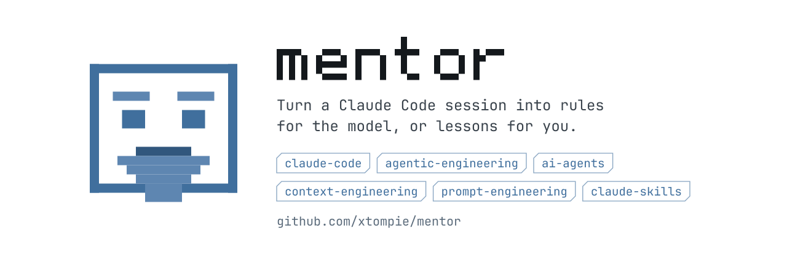
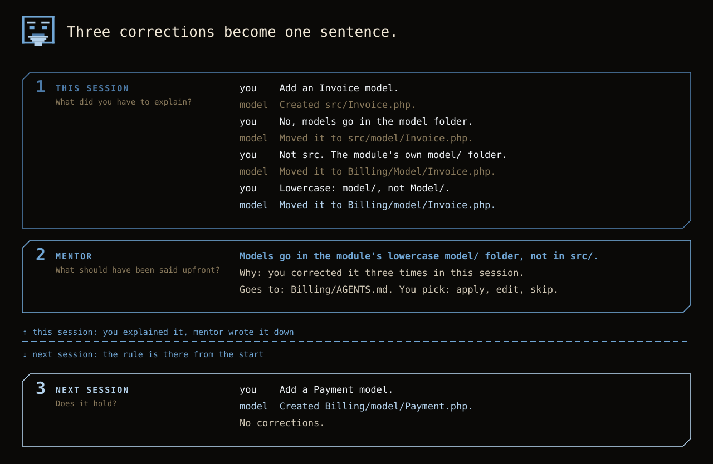

<picture>
  <source media="(prefers-color-scheme: dark)" srcset="assets/banner-dark.svg">
  
</picture>

## In short

Turn a session into rules for the model, or lessons for you.

- Reads a Claude Code session: the current one, an id, or a file.
- Asks first: improve the model, or learn something yourself?
- For the model: finds what you had to explain, writes one-line rules.
- For you: names the idea, says why it matters, shows it in your own code.
- Checks existing rules first, so nothing is written twice.
- Suggests where each rule goes: project doc, skill, or your notes.
- Writes nothing until you approve.



## Why

You ask for something. The model gets it almost right. You explain. Once, twice, five times. Then it works.

Next time the same thing happens, because nothing remembers what you explained. One sentence at the start would have done it: "Models go in `model/`, not `src/Entity/`."

Auto memory does not solve this well. It fills up with things that do not matter, it is rarely pruned, and it skips facts it thinks the model can read from the code, like where files go. Rules work better in files you control: the project's `AGENTS.md` or `CLAUDE.md`, a skill, your notes.

mentor finds those sentences in a finished session and hands them to you.

## Two modes

**Rules, for the model.** One imperative sentence each, with the quote from the session that proves it was needed, and a place to put it. "Put models in `model/`, not in `src/Entity/`."

**Lessons, for you.** When you learn something in a session, mentor names it so you can look it up, says in two or three sentences why it matters, and points at the place in your code. From a code review:

- **Separate construction from use.** `send()` built its renderer and mailer with `new` and then used them. Building belongs in a factory; the class that works gets ready objects.
- **Leaky abstraction.** `Billing::charge()` returned Stripe's class. A module returns its own types, or every caller depends on what it uses inside.

Ask for both, and you get both.

## How it works

1. `/mentor` in the session you just finished. Or `/mentor <session id>`, or `/mentor <file>.jsonl`.
2. It converts the session to compact text: what you said, what the model said, one line per tool call.
3. It asks one question: rules, lessons, or both.
4. It looks for the moments you had to explain: you came back after "done", you repeated yourself, you interrupted, you rejected a tool call. Creative back-and-forth ("shorter", "another color") does not count.
5. It checks the rules you already have. A rule that exists and was broken gets strengthened, not duplicated.
6. It shows a numbered list. You answer per item: apply, edit, or skip.
7. It writes only what you approved, one line at a time, and shows the diff.

Zero rules is a fine result. Most sessions do not need one.

If you use [Droid](https://github.com/xtompie/droid) and a droid owns the topic, mentor offers to queue the rule to that droid instead.

## Install

Paste this into Claude Code:

```text
Install mentor from https://github.com/xtompie/mentor. Follow INSTALL.md from that repo.
```

The agent asks whether to install it for your user or for one project. For your user is better: mentor works on any session, in any project.

To upgrade later, paste the same line with "Upgrade" instead of "Install". The agent reads the installed version and applies what changed since, from `CHANGELOG.md`.

Requirements: Claude Code 2.1.310 or newer, macOS or Linux, `perl` (preinstalled on both). Windows should work through Git Bash, which ships perl, but is not tested.

## Tests

```bash
tests/converter.sh                    # the session converter, no model
tests/run.sh                          # every case once, on Haiku
tests/run.sh rules-models --runs 3 --model sonnet
```

Each case starts a real Claude Code session (`claude -p`) in a fresh temporary project, installs the skill as `/mt` so it does not clash with your installed `/mentor`, feeds it a recorded session from `tests/fixtures/`, and checks the answer with plain shell. It also checks that no file was written without approval. Cases cost tokens.

## Credits

- [retro](https://github.com/craftwork-design/retro): ranking correction signals, creative iteration is not a correction, strengthen an old rule instead of adding a new one.
- [nomore](https://github.com/globalmpc/nomore): detecting corrections from interrupts, rejected tool calls and undone edits.
- [claude-reflect](https://github.com/BayramAnnakov/claude-reflect): apply, edit or skip per proposed rule.
- Claude Code docs, [memory and CLAUDE.md](https://code.claude.com/docs/en/memory): specific rules over general ones.
- Zhao et al., [ExpeL: LLM Agents Are Experiential Learners](https://arxiv.org/abs/2308.10144): lessons from contrasting a failed and a working attempt.
